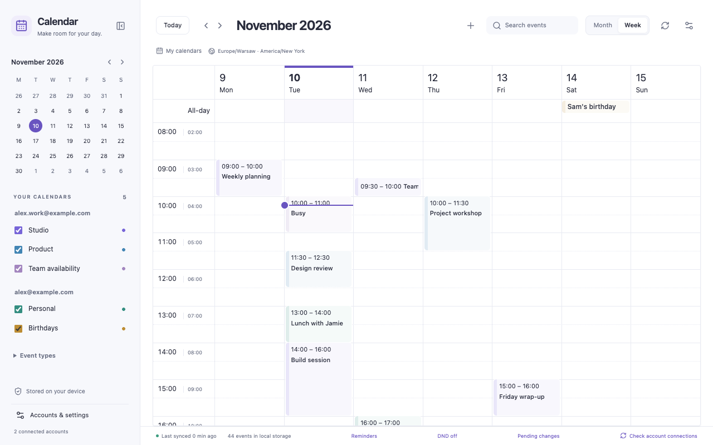

# Calendar Checker

**Privacy first. 100% free. No subscriptions. No hidden costs.**

Your work meetings, family plans and personal appointments, together in one calm view. Calendar Checker brings your Google calendars into Chrome so you can see what's next, make plans and get on with your day.

[Take a look](https://burnpiro.github.io/calendar-checker/) · [Get started](docs/INSTALLATION.md) · [Our privacy promise](https://burnpiro.github.io/calendar-checker/privacy.html)

_All names, accounts and events in the screenshots are fictional._

## Less switching. More clarity.

- **Bring work and life together.** Connect more than one Google account and choose which calendars you want to see.
- **See the month or plan your week.** Get the big picture, then give each day the attention it needs.
- **Know what's next at a glance.** Check your next event's time on the Chrome toolbar, or open the calendar with a click.
- **Make plans in the same place.** Create and edit events, invite guests, add a location or Google Meet, and set up repeating plans.
- **Get a nudge that suits you.** Choose desktop alerts, your own notification sounds and snooze times. Set quiet hours when you need to focus or switch off.
- **Make time zones easier.** See two time zones side by side when your day crosses borders.
- **Keep your saved plans close.** Already saved events remain available when you're offline. Changes wait until they can be sent to Google.
- **Make it feel like yours.** Choose light or dark mode, a roomier or more compact layout, and the calendars and reminders that matter to you.

[Explore all the features and screens →](https://burnpiro.github.io/calendar-checker/#features)

## Your day is personal. It should stay that way.

Calendar Checker saves its copy of your calendar, preferences and notification sounds **on your computer**. It doesn't send your calendar to the developer, sell your data or track how you use the extension. There are no ads.

You choose which Google accounts to connect. Sign-in and calendar updates go directly to Google. Your original events stay in your Google accounts; Calendar Checker's saved copy stays in Chrome on your computer.

Want to keep sensitive event notes out of that saved copy? Turn on **Exclude event descriptions** in Settings. It removes previously downloaded descriptions too. Descriptions you write yourself stay with unsent changes until Google saves them, so your work isn't lost.

[Read the plain-language privacy policy →](https://burnpiro.github.io/calendar-checker/privacy.html)

## All the features. None of the fees.

**Calendar Checker is 100% free to use.** No subscription, no paid upgrade and no hidden costs. The features you see here are included.

It's also open source: anyone can look at how it works. The code is available under the [GPL-3.0 license](LICENSE).

## Get started

Calendar Checker is in **early access**. It isn't in the Chrome Web Store yet, so this version needs manual installation and a one-time Google setup. The [installation guide](docs/INSTALLATION.md) walks through what's needed.

Once installed:

1. Connect the Google accounts you want to use.
2. Choose your calendars, preferred view and reminders.
3. Pin Calendar Checker in Chrome and check your day whenever you need it.

## A few things you might want to know

**Does it replace Google Calendar?**

It works with it. You still use your existing accounts and calendars, and changes you save are sent to Google.

**What happens if I lose my connection?**

You can still see events that were already saved on this computer. Unsaved-to-Google changes wait for access to return. Dates that haven't been saved are clearly marked.

**Can I turn off saved calendar data by setting both month counts to zero?**

No. That still keeps the current month, and viewing the calendar can also save a three-month browsing window. Use **Exclude event descriptions** if you want fewer event details saved. Other details remain on your computer.

**Will reminders work when Chrome is closed?**

Chrome needs to be running. Sleep, quiet hours and your computer's notification settings can delay or silence alerts.

**What if Google asks me to sign in again?**

Use **Reconnect** for that account. Your saved calendar information stays available while you reconnect.

## Need a hand?

[Installation guide](docs/INSTALLATION.md) · [Ask a question or report a problem](https://github.com/burnpiro/calendar-checker/issues)

Building or contributing? See the [development guide](docs/DEVELOPMENT.md), [technical reference](docs/TECHNICAL-REFERENCE.md), [architecture](docs/ARCHITECTURE.md) and [current progress](docs/STATUS.md).

_An independent project. Not affiliated with Google._
